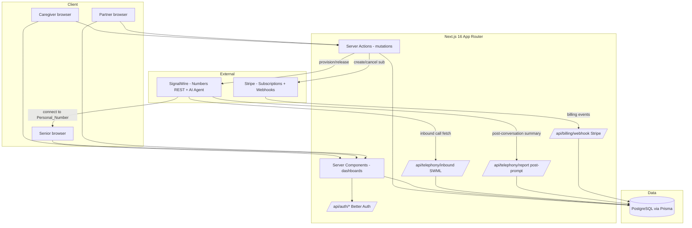

# Design Document

## Overview

Senior Call Shield (working name **Mabel**) protects seniors from spam and fraud calls while giving caregivers oversight. This design builds the feature on the project's existing stack and does not introduce a new one: Next.js 16 App Router with React 19 Server Components, TypeScript, Better Auth, Prisma 7 against PostgreSQL (via `@prisma/adapter-pg`, client generated to `src/generated/prisma`), and shadcn/ui + Radix + Tailwind v4. Telephony runs on SignalWire (REST number provisioning, inbound call handling via SWML, and the SignalWire AI Agent for screening). Billing runs on Stripe (subscriptions, metered per-member quantity, and signature-verified webhooks), with Stripe as the system of record for subscription state.

The system has three roles layered on a single Better Auth account model: **Caregiver**, **Senior**, and **Partner**. A Caregiver provisions a SignalWire **Protection_Number** that forwards to the Senior's **Personal_Number**. Inbound calls are screened: a **Known_Contact** bypasses screening and connects directly, while an **Unknown_Caller** is handed to the AI **Screening_Agent**, which produces a **Risk_Assessment** that decides whether the call connects. Every call yields a **Call_Record**, and unknown-caller interactions yield an AI **Call_Report**. Call forwarding is active only when both a valid **Consent_Record** and an active **Subscription** exist for the Senior.

This design maps each major decision back to the 14 requirements. The call-handling logic (normalization matching, risk gating, forwarding gating) is pure and deterministic where possible, so it can be validated with property-based tests; the SignalWire/Stripe integration edges are validated with integration and mock-based tests.

### Key design decisions

- **Single account table, role rows.** Roles are modeled as explicit rows (`CaregiverProfile`, `SeniorProfile`, `PartnerProfile`) keyed to the Better Auth `User.id`, rather than an enum column, to satisfy the "exactly one role" rules (Req 1.3, 1.4) and to carry role-specific data. This keeps the existing `User` model untouched and aligns with the workspace rule to avoid enums.
- **SWML returned by a Next.js route handler.** SignalWire fetches the call flow by POSTing to `/api/telephony/inbound`, which returns a SWML JSON document. This keeps all routing logic server-side and testable (Req 4.5, 6.1).
- **Forwarding gate is a single pure predicate.** `isForwardingActive(senior)` = consent valid AND subscription active AND not past-due/canceled. Every connect decision and every reconciliation path calls it, so the invariant holds in one place (Req 3.3, 6.3, 12.5, 12.6).
- **Stripe is source of truth; local state is a projection.** Subscription state is reconciled from signature-verified webhooks, deduplicated by Stripe event id for idempotence (Req 12.12, 14.5).
- **E.164 normalization via `libphonenumber-js`.** A well-maintained, pure library gives deterministic, idempotent normalization and matching (Req 11).

## Architecture

### System context



### Request/flow boundaries

- **Dashboards (reads):** React Server Components load data directly through Prisma inside the authenticated request, scoped to the viewer. No client-side data fetching (workspace rule: favor RSC/SSR).
- **Mutations:** Server Actions (`"use server"`) handle allowlist edits, provisioning, consent, and billing actions. Each action re-derives the session and authorization scope server-side.
- **Telephony:** SignalWire-driven HTTP route handlers return SWML or acknowledge summaries. These are unauthenticated by session but validated by a shared-secret token on the webhook URL plus the SignalWire signature where available.
- **Billing:** Stripe-driven webhook route handler verifies the Stripe signature before any state change.

### Layering

A thin `src/lib` service layer holds the pure decision logic and the external-client wrappers, so route handlers and server actions stay thin:

- `src/lib/phone.ts` — E.164 normalization and matching (pure).
- `src/lib/screening.ts` — risk gating and forwarding-gate predicate (pure).
- `src/lib/signalwire.ts` — REST client wrapper (purchase/release/configure number) and SWML builders.
- `src/lib/stripe.ts` — Stripe client wrapper and subscription mappers.
- `src/lib/authz.ts` — role resolution and Care_Link/Partner scoping checks.

## Components and Interfaces

### Role model on Better Auth

Better Auth owns `User`, `Session`, `Account`, `Verification` (unchanged). Role membership lives in separate profile tables so that a single account resolves to exactly one role at creation time:

- Registration via the caregiver flow creates a `User` + `CaregiverProfile` (Req 1.3).
- Caregiver-initiated Senior setup creates a `User` + `SeniorProfile` (Req 1.4).
- Partner enrollment creates a `User` + `PartnerProfile`.

`resolveRole(userId)` returns `"caregiver" | "senior" | "partner"` by checking which profile row exists; a const map (not an enum) defines the role keys. Dashboard access is enforced in layout-level Server Components and in every Server Action:

- Caregiver role → Caregiver_Dashboard allowed, Senior_Dashboard denied (Req 1.6).
- Senior role → Senior_Dashboard allowed, Caregiver_Dashboard denied (Req 1.7).

Email validation (RFC 5322, ≤254 chars) and password length (8–128) are enforced in the registration Server Action before delegating to Better Auth; duplicate email is rejected case-insensitively (Req 1.1, 1.2, 1.5). `User.email` already has a unique constraint, and emails are lowercased before comparison.

### Authorization scoping (`src/lib/authz.ts`)

```ts
export interface AuthContext {
  readonly userId: string;
  readonly role: "caregiver" | "senior" | "partner";
}

// Returns true only when an ACTIVE Care_Link exists between caregiver and senior.
export const assertCareLink = async (
  caregiverUserId: string,
  seniorId: string,
): Promise<void> => { /* throws AuthorizationError when absent */ };

// Returns true only when the senior is actively enrolled under the partner.
export const assertPartnerMembership = async (
  partnerUserId: string,
  seniorId: string,
): Promise<void> => { /* throws AuthorizationError when absent */ };
```

Every Caregiver read/write for a Senior passes through `assertCareLink`; every Partner billing read/write passes through `assertPartnerMembership` (Req 2.4, 2.5, 7.4, 8.5, 9.4, 12.3, 12.10, 13.6).

### Telephony client (`src/lib/signalwire.ts`)

Wraps the SignalWire REST Phone Numbers Inventory API:

- `searchAvailable(region)` → pick a purchasable number.
- `purchaseNumber({ areaCode })` → buy and return the E.164 number and SignalWire id (Req 4.1).
- `configureInboundHandler(numberId, swmlUrl)` → set the number's inbound voice handler to the Mabel SWML endpoint (Req 4.5).
- `releaseNumber(numberId)` → release through SignalWire (Req 4.7).

All calls use `SIGNALWIRE_PROJECT_ID` / `SIGNALWIRE_API_TOKEN` / `SIGNALWIRE_SPACE_URL` from environment; never hardcoded. Failures surface as typed errors so the provisioning action can report failure without leaving partial state (Req 4.6, 4.8).

### SWML builders and the call-handling route handler

`/api/telephony/inbound` (POST) receives the SignalWire inbound call webhook payload (`call.from_number`, `call.to`, etc.) and returns a SWML JSON document. The handler:

1. Resolves the Senior by the called Protection_Number (`call.to`).
2. If forwarding is inactive for that Senior → return a SWML document that records a "not forwarded" outcome and hangs up; the call is logged with that outcome (Req 6.3).
3. Normalizes `call.from_number` to E.164 (Req 11.3). On normalization failure, treats the caller as Unknown and records a normalization-failure indication (Req 11.4).
4. If the normalized number matches a Known_Contact → return a SWML document that immediately `connect`s to the Personal_Number with no screening (Req 5.4), stamping the Known_Contact display name into the Call_Record (Req 5.7).
5. Otherwise (Unknown_Caller) → return a SWML document with an `answer` + `ai` block. The `ai` prompt instructs the Screening_Agent to gather call intent; a SWAIG `data_map`/webhook function or the `post_prompt_url` returns the structured outcome. The agent is bounded to a 60-second intent window; on timeout the document declines and records "unscreened" (Req 6.1, 6.6).

The AI block posts its conversation summary to `/api/telephony/report`, which computes the Risk_Assessment, writes the Call_Record and Call_Report, and (for Known/Allowed) either returns a follow-up SWML `connect` or, for Spam/Fraud, confirms the decline (Req 6.2, 6.4, 6.5).

SWML shapes (JSON) returned by the builders:

```jsonc
// Known-contact bypass: connect straight through.
{ "version": "1.0.0",
  "sections": { "main": [
    { "answer": {} },
    { "connect": { "to": "<E.164 Personal_Number>" } }
  ] } }

// Unknown caller: hand to the AI Screening_Agent.
{ "version": "1.0.0",
  "sections": { "main": [
    { "answer": {} },
    { "ai": {
      "prompt": { "text": "You are a call screener. Determine the caller's purpose..." },
      "post_prompt_url": "https://<host>/api/telephony/report?token=<secret>&call=<id>",
      "params": { "conversation_timeout": 60 }
    } },
    { "hangup": {} }
  ] } }

// Forwarding inactive: record and end.
{ "version": "1.0.0",
  "sections": { "main": [
    { "answer": {} },
    { "play": { "url": "say:This number is not accepting calls right now." } },
    { "hangup": {} }
  ] } }
```

### Billing client (`src/lib/stripe.ts`)

- `ensureBillingAccount(ownerUserId)` → find or create the Stripe customer; persist `BillingAccount` (Req 12.1, 13.1).
- `createFamilySubscription(seniorId, priceId)` → create a per-Senior subscription at a price in $14.99–$19.99 (Req 12.2).
- `cancelSubscription(subscriptionId)` → request cancellation (Req 12.9).
- `createPartnerSubscription(partnerId, priceId, quantity)` / `setPartnerQuantity(subscriptionId, quantity)` → per-member quantity subscription with `quantity >= 0` (Req 13.2, 13.3, 13.4).

The Stripe price ids are configured via environment (`STRIPE_FAMILY_PRICE_ID`, `STRIPE_PARTNER_PRICE_ID`) so the monthly amount constraint is enforced by the configured Stripe Price, not in application code.

### Billing webhook (`/api/billing/webhook`)

POST handler that:

1. Reads the raw request body (Next.js route handler, `request.text()`), verifies the `Stripe-Signature` header with `STRIPE_WEBHOOK_SECRET` using `stripe.webhooks.constructEvent`. On failure → HTTP 400, no state change (Req 14.2, 14.3).
2. Looks up the Stripe event id in `ProcessedWebhookEvent`. If present → return the prior result without re-applying (Req 14.5).
3. For `customer.subscription.*` lifecycle events, maps to a local state (`created`/`updated`/`past_due`/`canceled`), updates the `Subscription` row, and re-runs the forwarding gate for each affected Senior within the 60-second budget (Req 12.7, 13.7, 14.4).
4. If the event cannot be matched to a known `BillingAccount`/`Subscription` → record the unmatched event and return HTTP 200 (Req 14.6).
5. Records the event id in `ProcessedWebhookEvent` inside the same transaction as the state change.

### Dashboards

- **Caregiver_Dashboard** (`/dashboard` for caregiver role): RSC loads the list of linked Seniors (active Care_Links) within the request; empty state when none (Req 9.1, 9.2). Selecting a Senior loads that Senior's Call_Records, Call_Reports, Known_Contacts, Protection_Number status, and Subscription state, all scoped by `assertCareLink` (Req 9.3, 9.4, 9.8). Known_Contact add/remove are Server Actions that revalidate the list and preserve prior state on failure (Req 9.5, 9.6, 9.7).
- **Senior_Dashboard** (`/dashboard` for senior role): RSC loads the authenticated Senior's 20 most recent Call_Records (newest first), Known_Contacts, and forwarding status (`active`/`inactive`), scoped strictly to the authenticated Senior (Req 10.1–10.6). Load failure shows an error state and never another Senior's data (Req 10.7).
- **Partner view** (`/dashboard` for partner role): RSC loads the per-member Subscription state and billed quantity for the Partner's own members (Req 13.5), scoped by `assertPartnerMembership`.

Client interactivity (`"use client"`) is limited to small controls (add-contact dialog, confirm buttons) built on shadcn/ui + Radix; lists and status render on the server.

### API surface

Route handlers:

| Path | Method | Purpose | Requirements |
|------|--------|---------|--------------|
| `/api/auth/*` | GET/POST | Better Auth (existing) | 1 |
| `/api/telephony/inbound` | POST | Return SWML for an inbound call | 4.5, 5.4, 6.1, 6.3 |
| `/api/telephony/report` | POST | Receive AI summary, write Risk_Assessment/Call_Record/Call_Report, return connect/decline SWML | 6.2, 6.4, 6.5, 7.1, 8.1 |
| `/api/billing/webhook` | POST | Stripe signature-verified, idempotent reconciliation | 12.7, 12.12, 13.7, 14 |

Server Actions (grouped in `src/app/**/actions.ts`):

- `registerCaregiver`, `createSeniorProfile` (Req 1, 2.1)
- `removeCareLink` (Req 2.6)
- `submitConsent`, `withdrawConsent` (Req 3)
- `provisionProtectionNumber`, `releaseProtectionNumber` (Req 4)
- `addKnownContact`, `removeKnownContact` (Req 5, 9.5, 9.6)
- `subscribeFamilyPlan`, `cancelFamilyPlan`, `listSubscriptions` (Req 12)
- `enrollPartnerMember`, `removePartnerMember`, `getPartnerBilling` (Req 13)

A background job (scheduled task / cron route) deletes Call_Records older than the configured retention period (Req 7.7, 7.8).

## Data Models

New application models are added to `prisma/schema.prisma` alongside the existing Better Auth models. IDs are strings (cuid) to match the existing convention. Role and status values are stored as `String` columns constrained by application-level const maps rather than Prisma enums (workspace rule: avoid enums).

### Const value maps (application-level, not DB enums)

```ts
export const ROLES = { caregiver: "caregiver", senior: "senior", partner: "partner" } as const;
export const RISK_CATEGORIES = { known: "Known", allowed: "Allowed", spam: "Spam", fraud: "Fraud" } as const;
export const CALL_DISPOSITIONS = {
  connected: "connected", declined: "declined", notForwarded: "not_forwarded",
  unscreened: "unscreened", recordingFailure: "recording_failure",
} as const;
export const PROVISIONING_STATES = {
  none: "none", provisioning: "provisioning", active: "active",
  releasing: "releasing", failed: "failed",
} as const;
export const SUBSCRIPTION_STATES = {
  active: "active", pastDue: "past_due", canceled: "canceled", incomplete: "incomplete",
} as const;
export const FORWARDING_STATES = { active: "active", inactive: "inactive" } as const;
```

### Schema additions

```prisma
model CaregiverProfile {
  id        String     @id @default(cuid())
  userId    String     @unique
  user      User       @relation(fields: [userId], references: [id], onDelete: Cascade)
  careLinks CareLink[]
  billing   BillingAccount?
  createdAt DateTime   @default(now())
  updatedAt DateTime   @updatedAt
  @@map("caregiver_profile")
}

model SeniorProfile {
  id               String            @id @default(cuid())
  userId           String            @unique
  user             User              @relation(fields: [userId], references: [id], onDelete: Cascade)
  careLinks        CareLink[]
  protectionNumber ProtectionNumber?
  knownContacts    KnownContact[]
  consent          ConsentRecord?
  callRecords      CallRecord[]
  subscription     Subscription?
  partnerMembership PartnerMembership?
  forwardingActive Boolean           @default(false)
  createdAt        DateTime          @default(now())
  updatedAt        DateTime          @updatedAt
  @@map("senior_profile")
}

model PartnerProfile {
  id          String              @id @default(cuid())
  userId      String              @unique
  user        User                @relation(fields: [userId], references: [id], onDelete: Cascade)
  memberships PartnerMembership[]
  billing     BillingAccount?
  subscription Subscription?
  createdAt   DateTime            @default(now())
  updatedAt   DateTime            @updatedAt
  @@map("partner_profile")
}

model CareLink {
  id          String           @id @default(cuid())
  caregiverId String
  caregiver   CaregiverProfile @relation(fields: [caregiverId], references: [id], onDelete: Cascade)
  seniorId    String
  senior      SeniorProfile    @relation(fields: [seniorId], references: [id], onDelete: Cascade)
  active      Boolean          @default(true)
  createdAt   DateTime         @default(now())
  updatedAt   DateTime         @updatedAt
  @@unique([caregiverId, seniorId])
  @@index([caregiverId, active])
  @@map("care_link")
}

model ProtectionNumber {
  id              String        @id @default(cuid())
  seniorId        String        @unique
  senior          SeniorProfile @relation(fields: [seniorId], references: [id], onDelete: Cascade)
  e164Number      String        @unique            // the provisioned Protection_Number
  personalNumber  String                           // E.164 Personal_Number to forward to
  signalwireId    String?                          // SignalWire number resource id
  provisioningState String      @default("none")   // PROVISIONING_STATES
  createdAt       DateTime      @default(now())
  updatedAt       DateTime      @updatedAt
  @@map("protection_number")
}

model KnownContact {
  id          String        @id @default(cuid())
  seniorId    String
  senior      SeniorProfile @relation(fields: [seniorId], references: [id], onDelete: Cascade)
  e164Number  String                                 // normalized E.164
  displayName String?       @db.VarChar(100)
  createdAt   DateTime      @default(now())
  updatedAt   DateTime      @updatedAt
  @@unique([seniorId, e164Number])
  @@map("known_contact")
}

model ConsentRecord {
  id               String        @id @default(cuid())
  seniorId         String        @unique
  senior           SeniorProfile @relation(fields: [seniorId], references: [id], onDelete: Cascade)
  protectionNumber String                              // Protection_Number at time of consent
  consentedAt      DateTime                            // UTC, second precision
  withdrawn        Boolean       @default(false)
  createdAt        DateTime      @default(now())
  @@map("consent_record")
}

model CallRecord {
  id                String        @id @default(cuid())
  seniorId          String
  senior            SeniorProfile @relation(fields: [seniorId], references: [id], onDelete: Cascade)
  callerNumber      String                             // normalized E.164 or raw on failure
  rawCallerNumber   String?                            // preserved original on normalization failure
  normalizationFailed Boolean     @default(false)
  knownContactName  String?                            // display name when a Known_Contact matched
  startedAt         DateTime                           // UTC
  endedAt           DateTime?                          // UTC
  screeningOutcome  String                             // outcome text
  riskCategory      String?                            // RISK_CATEGORIES
  riskScore         Int?                               // 0..100
  disposition       String                             // CALL_DISPOSITIONS
  report            CallReport?
  createdAt         DateTime      @default(now())
  @@index([seniorId, startedAt(sort: Desc)])
  @@map("call_record")
}

model CallReport {
  id            String     @id @default(cuid())
  callRecordId  String     @unique
  callRecord    CallRecord @relation(fields: [callRecordId], references: [id], onDelete: Cascade)
  statedPurpose String     @default("undetermined")
  riskCategory  String
  reasonText    String
  available     Boolean    @default(true)
  createdAt     DateTime   @default(now())
  @@map("call_report")
}

model BillingAccount {
  id               String            @id @default(cuid())
  caregiverId      String?           @unique
  caregiver        CaregiverProfile? @relation(fields: [caregiverId], references: [id], onDelete: Cascade)
  partnerId        String?           @unique
  partner          PartnerProfile?   @relation(fields: [partnerId], references: [id], onDelete: Cascade)
  stripeCustomerId String            @unique
  createdAt        DateTime          @default(now())
  updatedAt        DateTime          @updatedAt
  @@map("billing_account")
}

model Subscription {
  id                   String          @id @default(cuid())
  stripeSubscriptionId String          @unique
  seniorId             String?         @unique            // Family_Plan: one per Senior
  senior               SeniorProfile?  @relation(fields: [seniorId], references: [id], onDelete: Cascade)
  partnerId            String?         @unique            // Partner per-member plan
  partner              PartnerProfile? @relation(fields: [partnerId], references: [id], onDelete: Cascade)
  state                String                             // SUBSCRIPTION_STATES (mirrors Stripe)
  monthlyPriceCents    Int?                               // Family_Plan price snapshot
  quantity             Int?                               // Partner per-member billed quantity (>= 0)
  createdAt            DateTime        @default(now())
  updatedAt            DateTime        @updatedAt
  @@map("subscription")
}

model PartnerMembership {
  id        String         @id @default(cuid())
  partnerId String
  partner   PartnerProfile @relation(fields: [partnerId], references: [id], onDelete: Cascade)
  seniorId  String         @unique
  senior    SeniorProfile  @relation(fields: [seniorId], references: [id], onDelete: Cascade)
  active    Boolean        @default(true)
  createdAt DateTime       @default(now())
  updatedAt DateTime       @updatedAt
  @@index([partnerId, active])
  @@map("partner_membership")
}

model ProcessedWebhookEvent {
  id            String   @id @default(cuid())
  stripeEventId String   @unique            // dedup key for idempotence
  eventType     String
  matched       Boolean  @default(true)     // false = recorded unmatched event
  processedAt   DateTime @default(now())
  @@map("processed_webhook_event")
}

model RetentionConfig {
  id            String @id @default(cuid())
  retentionDays Int    @default(365)        // 1..3650, default 365
  @@map("retention_config")
}
```

The existing `User` model gains back-relations to the three profile tables (`CaregiverProfile?`, `SeniorProfile?`, `PartnerProfile?`); no other change to the Better Auth tables.

### Model notes mapped to requirements

- `SeniorProfile.forwardingActive` is the materialized result of the forwarding gate, updated whenever consent, subscription, or provisioning changes. The Senior_Dashboard reads it directly as `active`/`inactive` (Req 10.5).
- `Subscription` is a one-of between Senior (Family_Plan) and Partner (per-member); `state` mirrors Stripe and is only written by reconciliation (Req 12.12).
- `ProcessedWebhookEvent.stripeEventId` is unique, giving the idempotence guarantee at the database level (Req 14.5).
- `CallRecord.rawCallerNumber` + `normalizationFailed` preserve the original value when normalization fails (Req 11.4).

## Correctness Properties

*A property is a characteristic or behavior that should hold true across all valid executions of a system — essentially, a formal statement about what the system should do. Properties serve as the bridge between human-readable specifications and machine-verifiable correctness guarantees.*

The properties below cover the pure, input-varying logic of the system: phone-number normalization/matching, the risk-to-disposition mapping, the forwarding gate, and webhook idempotence. Integration-heavy criteria (SignalWire provisioning, Stripe API calls, dashboard rendering, latency budgets) are covered by integration, mock-based, and example tests in the Testing Strategy rather than by properties.

### Property 1: E.164 normalization is idempotent

*For any* telephone number value that normalizes to a valid E.164 string, normalizing that already-normalized E.164 value again SHALL produce a character-for-character identical E.164 value.

**Validates: Requirements 11.5, 11.1**

### Property 2: Known-contact matching is exact on normalized forms

*For any* stored Known_Contact and any inbound Caller_Number, the system SHALL treat the caller as matching that Known_Contact if and only if their full E.164 normalized strings are character-for-character identical.

**Validates: Requirements 11.3, 5.4**

### Property 3: Invalid caller numbers fall through to Unknown without mutation

*For any* inbound Caller_Number that is empty, contains disallowed characters, or cannot be resolved to a valid 1–15 digit E.164 value, the system SHALL classify the Caller as Unknown, record a normalization-failure indication, and retain the original unmodified Caller_Number value.

**Validates: Requirements 11.4**

### Property 4: Risk category determines connect-vs-decline disposition

*For any* produced Risk_Assessment, the call disposition SHALL be "connected" when the category is Known or Allowed and SHALL be "declined" when the category is Spam or Fraud, and the risk score SHALL always be an integer in the inclusive range 0 to 100.

**Validates: Requirements 6.2, 6.4, 6.5**

### Property 5: Forwarding is active if and only if consent and an active subscription both hold

*For any* Senior, the forwarding gate SHALL evaluate to active if and only if a valid non-withdrawn Consent_Record exists AND an active Subscription exists that is not in past-due or canceled state; in every other combination it SHALL evaluate to inactive.

**Validates: Requirements 3.3, 6.3, 12.5, 12.6, 12.7**

### Property 6: Webhook processing is idempotent by event id

*For any* signature-verified billing event, processing an event whose Stripe event id matches a previously processed event SHALL produce the same resulting Subscription and forwarding state as the first processing and SHALL NOT apply the event a second time.

**Validates: Requirements 14.5**

### Property 7: Care-link scoping confines Senior data to linked caregivers

*For any* Caregiver and Senior, a request for that Senior's settings, call history, or reports SHALL succeed only when an active Care_Link exists between them, and SHALL otherwise return an authorization error and no Senior data.

**Validates: Requirements 2.4, 2.5, 7.4, 8.5, 9.4**

### Property 8: Partner billed quantity never goes negative

*For any* sequence of member enrollments and removals under a Partner, the Partner Subscription's billed quantity SHALL equal the count of active enrolled Seniors and SHALL never fall below zero.

**Validates: Requirements 13.3, 13.4**

### Property 9: Call history ordering is newest-first

*For any* set of Call_Records for a Senior, a call-history request SHALL return them ordered by call start timestamp in strictly descending order (most recent first), and an empty set SHALL return an empty result rather than an error.

**Validates: Requirements 7.3, 7.5, 7.6, 10.1**

## Error Handling

- **Validation errors (registration, phone format, consent fields):** Server Actions return a typed result object `{ ok: false, field, message }`; no partial writes occur (Req 1.2, 3.4, 4.4, 5.2). The UI renders the field-level message via shadcn form state and `sonner` toasts.
- **Duplicate/constraint conflicts:** Unique constraints (`User.email`, `CareLink[caregiverId,seniorId]`, `KnownContact[seniorId,e164Number]`, `Subscription.seniorId`) surface as conflict errors mapped to user-facing "already exists" messages, leaving existing rows unchanged (Req 1.5, 2.3, 4.2, 5.3, 12.4).
- **Care-link cap:** Creating a Care_Link checks the active count (≤50) in the same transaction and rejects over-cap requests without mutation (Req 2.3).
- **SignalWire failures:** `signalwire.ts` throws typed `TelephonyError`. Provisioning sets `provisioningState = "failed"`, stores no Personal_Number, and reports failure (Req 4.6). Release failure keeps the number `active` and reports failure (Req 4.8).
- **Screening timeout / no intent:** The SWML `ai` block is bounded to 60 seconds; on timeout the report handler records disposition `unscreened` and declines (Req 6.6).
- **Call_Record write failures:** The report handler retries Call_Record creation up to 3 times; on exhaustion it writes a minimal record with disposition `recording_failure` preserving `callerNumber` and `startedAt` (Req 7.2).
- **Call_Report generation failure:** The Call_Record (with Risk_Assessment) is committed first; report failure marks `CallReport.available = false` without rolling back the Call_Record (Req 8.6).
- **Stripe failures:** `stripe.ts` throws typed `BillingError`; subscribe/cancel actions report the failure and leave prior Subscription state unchanged (Req 12.11, 13.8).
- **Webhook signature failure:** HTTP 400, no state change (Req 14.3). Unmatched verified events: recorded, HTTP 200, no forwarding change (Req 14.6).
- **Dashboard load failure:** RSC error boundaries (`error.tsx`) render a load-failure message and never fall back to another user's data (Req 10.7, 9.4).

Secrets (`DATABASE_URL`, `BETTER_AUTH_SECRET`, `SIGNALWIRE_*`, `STRIPE_SECRET_KEY`, `STRIPE_WEBHOOK_SECRET`, SWML webhook shared-secret token) are read from environment only and never logged. Telephony and billing webhook URLs carry a shared-secret token and are additionally validated by provider signature where available.

## Testing Strategy

### Approach

- **Unit tests** cover specific examples, edge cases, and error conditions.
- **Property-based tests** cover the pure, input-varying logic (normalization, matching, risk mapping, forwarding gate, idempotence) listed in Correctness Properties.
- **Integration / mock-based tests** cover the SignalWire and Stripe edges, the SWML route handler shape, and dashboard data loading, where behavior does not vary meaningfully with input or depends on external services.

PBT applies here because the core decision logic is pure and has a large input space (arbitrary phone numbers, risk assessments, consent/subscription combinations, event sequences). PBT does NOT apply to SignalWire provisioning, Stripe API calls, SWML/UI rendering, or latency budgets — those use integration and example tests instead.

### Property-based testing

- **Library:** `fast-check` with `vitest` (standard for the TS/React ecosystem; no hand-rolled PBT).
- **Iterations:** each property test runs a minimum of 100 generated cases.
- **Tagging:** each property test is tagged with a comment in the form
  `// Feature: senior-call-shield, Property N: <property text>` and references its design property.
- **Mapping:** one property-based test per correctness property (Properties 1–9). Generators produce arbitrary phone strings (valid and malformed), Risk_Assessments, Senior consent/subscription state combinations, enrollment/removal sequences, and replayed webhook events. Stripe/SignalWire clients are mocked so property runs stay cheap.

### Unit and integration tests

- **Registration/auth:** examples for valid/invalid email and password bounds, duplicate email (case-insensitive), and role-to-dashboard access (Req 1).
- **Care_Link cap:** example at the 50-link boundary (Req 2.3).
- **Consent:** examples for missing-field rejection and withdrawal deactivating forwarding (Req 3.4, 3.5).
- **Provisioning:** mock SignalWire client — success, duplicate-active rejection, invalid Personal_Number, provider error (no partial state), release success/failure (Req 4).
- **SWML route handler:** assert the returned SWML JSON shape for the three paths (known-contact connect, unknown-caller AI block, forwarding-inactive hangup) using representative inbound payloads (Req 5.4, 6.1, 6.3).
- **Report handler:** examples mapping AI summaries to Risk_Assessment, Call_Record, and Call_Report, including the "undetermined" purpose case and report-failure path (Req 8.3, 8.6).
- **Billing webhook:** integration-style tests with mocked Stripe signature verification — valid lifecycle event updates state and re-gates forwarding; bad signature → 400; unmatched event → 200; replayed event id → no double apply (Req 14).
- **Retention job:** example deleting records older than the configured window and keeping newer ones (Req 7.7, 7.8).
- **Dashboards:** RSC data-loading tests asserting scoping (linked vs unlinked Senior, Senior sees only own data, empty states) (Req 9, 10).
